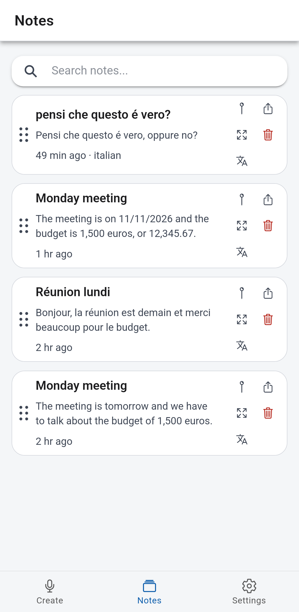
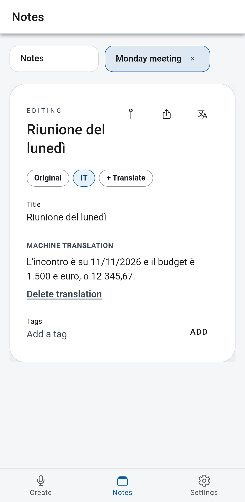
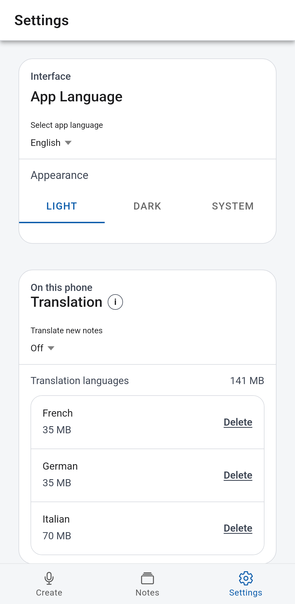

# Smart Offline Notes

Private voice notes for Android. Speech is transcribed on the phone, and notes can be translated on the phone. No account and no cloud. Live on Google Play in 178 countries.

[](https://play.google.com/store/apps/details?id=io.ldelg.smartofflinenotes)

[](https://github.com/ldelg/Smart-Offline-Notes-Ionic-MobileApp/releases/latest/download/Smart-Offline-Notes.apk)

**[Download the latest Android APK](https://github.com/ldelg/Smart-Offline-Notes-Ionic-MobileApp/releases/latest/download/Smart-Offline-Notes.apk)** (about 26 MB). That link always follows the [latest release](https://github.com/ldelg/Smart-Offline-Notes-Ionic-MobileApp/releases/latest). Each release also keeps a versioned APK and AAB.


To install the APK: open the link on your Android phone, tap the downloaded file, and allow your browser to install apps if Android asks. On first use the app asks before downloading the Whisper speech model. Language packs download the first time you translate. After that, transcription and translation work fully offline.

## Features

- On-device Whisper speech-to-text, with punctuation and paragraphs
- Pin a note, tag it, share it, and drag to reorder
- On-device translation between English, Spanish, French, German, and Italian
- More than one translation on a note, including the title, with numbers written for the language you are reading
- Offline after the speech model and language packs have been downloaded once
- Light and dark

Translation uses [Bergamot](https://github.com/browsermt/bergamot-translator), the engine behind Firefox Translations. The engine and the language packs are Mozilla Public License 2.0.

## Screenshots





## Local Development

From `frontend/`:

```powershell
npm run build
npx cap sync android
```

Then open `frontend/android` in Android Studio and run the app on a device or emulator.

## Translation

A note keeps its original text and can hold a translation for each of English, Spanish, French, German, and Italian. Pairs without a direct model (for example Spanish and Italian) go through English inside the engine. The original is never replaced by a translation of a translation.

The first time a language pair is needed, the app downloads that pack and the Bergamot engine from Mozilla. After that, translation works offline. Packs can be deleted in Settings. Speech models and translation packs are not loaded at the same time.

Whisper's old "translate to English" task is no longer in the app. Transcription always uses the transcribe task. If that Whisper option was turned on, it is migrated to auto-translate new notes into English.

## Licences and model hosting

Bergamot and the Firefox Translations models are Mozilla Public License 2.0.

- Engine glue included in the app: `frontend/src/assets/bergamot/bergamot-translator.js`, from [mozilla-firefox/firefox](https://github.com/mozilla-firefox/firefox/tree/main/toolkit/components/translations/bergamot-translator) (`v0.6.0+eea6e5a8`). The MPL text is beside that file. Mozilla's [translations](https://github.com/mozilla/translations) repository is the upstream project (MPL-2.0).
- Engine binary (not in this repository): Firefox Remote Settings collection `translations-wasm`, record version 3.0, release v0.6.0, SHA-256 `a3a89d9ad0a4ed8f27bf3e403701b23f5709816f6376438503f2fa5b0182c2dc`. Downloaded from `https://firefox-settings-attachments.cdn.mozilla.net/`.
- Language packs (not in this repository): Firefox Remote Settings collection `translations-models-v2`, architecture `base-memory`, version 3.0, about 35 MB each once decompressed. Same Mozilla CDN. Direct pairs are English with Spanish, French, German, and Italian, in both directions.

Mozilla confirmed the model weights use the same MPL-2.0 terms as the training repository ([mozilla/translations#1434](https://github.com/mozilla/translations/issues/1434)). The files are not re-hosted here. The in-app About / Licences screen links to the project and the MPL.
