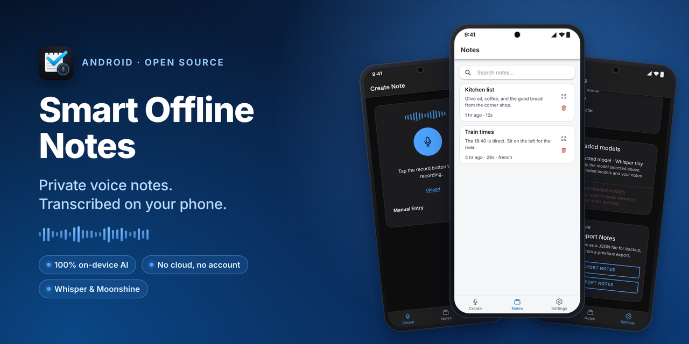
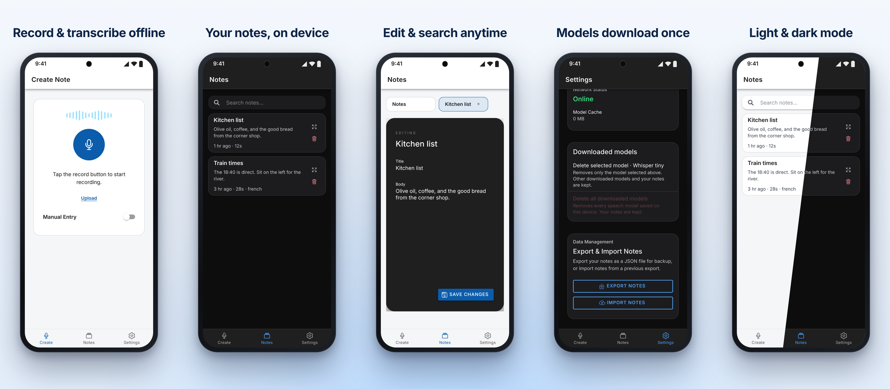

# Smart Offline Notes

Offline speech-to-notes mobile app built with Ionic, Angular, and Capacitor.

## Download

[](https://github.com/ldelg/Smart-Offline-Notes-Ionic-MobileApp/releases/latest/download/Smart-Offline-Notes.apk)

**[Download the latest Android APK](https://github.com/ldelg/Smart-Offline-Notes-Ionic-MobileApp/releases/latest/download/Smart-Offline-Notes.apk)** (about 26 MB, all versions are on the [Releases page](https://github.com/ldelg/Smart-Offline-Notes-Ionic-MobileApp/releases))





To install: open the link on your Android phone, tap the downloaded file, and allow your browser to install apps if Android asks. On first use the app asks before downloading the Whisper speech model; after that, transcription works fully offline.

## Local Development

From `frontend/`:

```powershell
npm run build
npx cap sync android
```

Then open `frontend/android` in Android Studio and run the app on a device or emulator.
